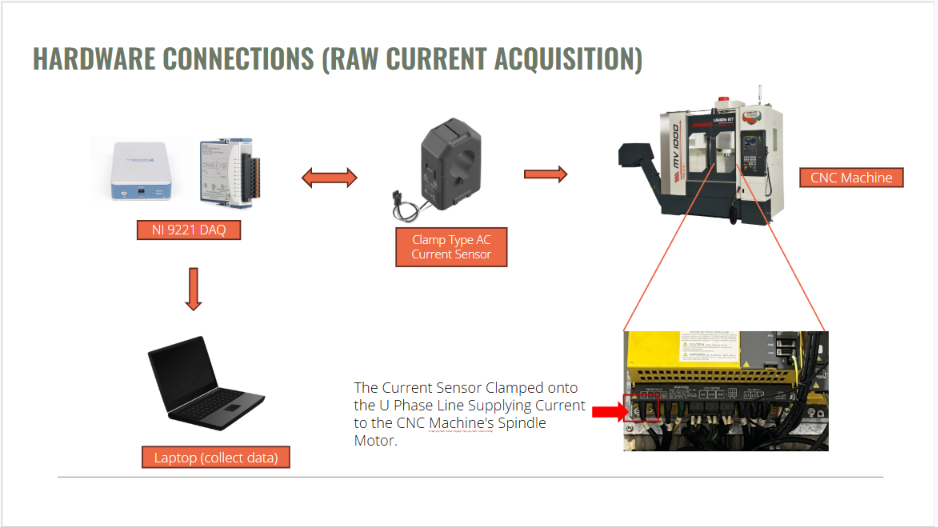
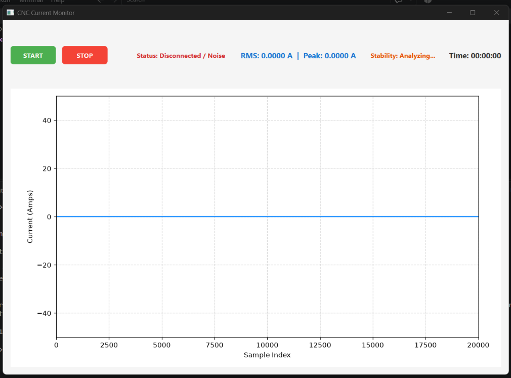
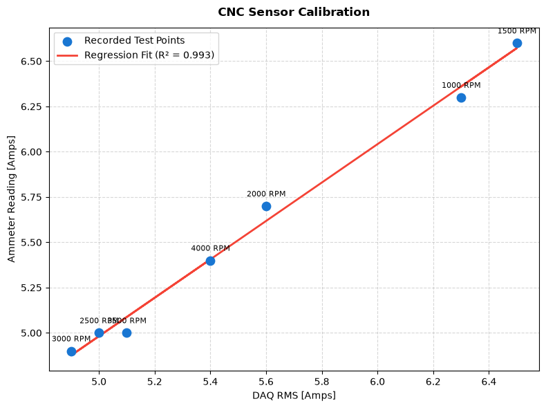

# CNC Spindle Current Monitor: Real-Time DAQ for Tool-Wear Monitoring

This repository contains a real-time Python-based data acquisition (DAQ) and monitoring system designed to measure and log the raw current of a CNC machine's spindle motor. Developed for research on predictive tool-wear monitoring during an internship at Kun Shan University (Taiwan), this application bridges low-level sensor data acquisition with a high-level PyQt6 graphical interface for seamless experimental data collection.

## ⚙️ Hardware Architecture

<!-- INSERT HARDWARE IMAGE HERE: Make sure 'image_6c8d65.png' is uploaded to your repository -->

  

The physical hardware pipeline safely isolates and acquires raw current data from the CNC machine:
* **Sensor:** A Clamp Type AC Current Sensor attached directly to the U-Phase line supplying current to the CNC Machine's Spindle Motor.
* **Data Acquisition:** The analog signal from the sensor feeds into an NI 9221 DAQ module (`cDAQ1Mod1/ai7` channel).
* **Host System:** A laptop interfaces with the DAQ via USB to continuously collect, process, and record the raw AC data.

## 💻 Software Features & GUI

<!-- INSERT GUI IMAGE HERE: Make sure 'Screenshot 2026-10-21 164003.png' is uploaded to your repository -->

  

The custom application provides a robust, thread-safe interface designed to run reliably during long machining operations without locking up the system kernel:
* **Real-Time Visualization:** Matplotlib integration displays live, continuous current waveforms with a rolling 20,000-sample viewing window.
* **Live Diagnostics:** Instantly calculates and displays the RMS Current, Peak Current, and Signal Stability parameters.
* **Smart Noise Gating:** Implements a disconnection noise threshold (`0.15A`) to automatically zero out open-circuit noise when the spindle is offline, only allowing valid phase currents to pass.
* **Thread-Safe Data Logging:** Utilizes background threads and queueing to continuously format and save per-minute `.csv` batch files with high-precision timestamps (HH:MM:SS.ffffff).

## 📊 Calibration & Accuracy Validation

<!-- INSERT REGRESSION GRAPH IMAGE HERE: Make sure 'finalcalibrationoutput (1).png' is uploaded to your repository -->

  

To validate the accuracy of the software's signal processing algorithm against physical ground-truth instruments, a linear regression test was performed.
* **Methodology:** The DAQ RMS outputs were mapped against physical Ammeter readings across various spindle speeds (from 1000 RPM up to 4000 RPM).
* **Validation Results:** The system demonstrated exceptional accuracy and linearity, achieving an **R² value of 0.993**.
* **Software Calibration:** Based on these empirical tests, a background calibration factor of `0.9086` is hardcoded into the data processing pipeline to align the raw voltage-derived DAQ RMS with true physical Ammeter readings.

## 🔧 System Configuration Parameters
The internal algorithm converts raw AC voltage to Primary Current using the following established hardware constants:
* **Sample Rate:** 20,000 Hz
* **Samples per Batch:** 20,000
* **Transformation Ratio:** 3000
* **Burden Resistance:** 1000.0 Ω
* **Stability Evaluation:** 5-second rolling window (Max Std Dev Limit: 0.05)

## 🛠️ Requirements & Dependencies
* Python 3.8+
* `PyQt6` (GUI framework)
* `nidaqmx` (NI-DAQmx hardware drivers)
* `matplotlib` (Live data plotting)
* `numpy` (Fast array operations and RMS calculations)

## 👤 Author
**Princess April E. Castillo**  
*4th-Year B.S. Computer Applications, Mindanao State University - Iligan Institute of Technology*
